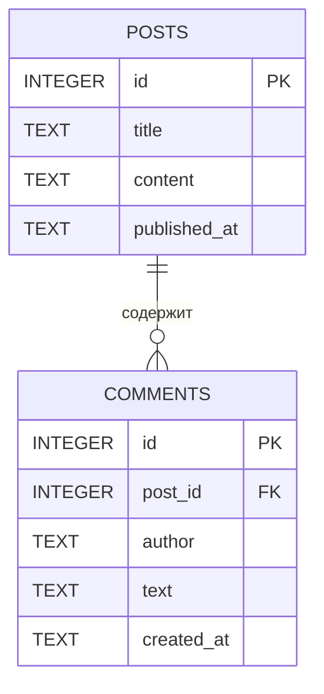
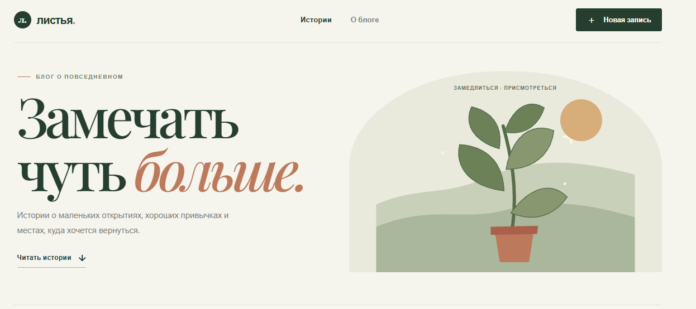

# Лабораторная работа № 8 — блог с постами и комментариями

**Студент:** Ярослав Бормотов  
**Тема:** «Блог с постами и комментариями»  
**Вариант:** 7

## О проекте

«Листья» — адаптивный блог о повседневных открытиях. Приложение позволяет просматривать и сортировать посты, переходить между страницами, открывать полный текст истории, оставлять комментарии и выполнять полный CRUD постов: создавать, читать, редактировать и удалять записи. Количество комментариев видно в карточке каждой истории.

При первом запуске база данных автоматически создаётся и заполняется тремя примерами историй. Посты и комментарии хранятся локально и сохраняются после перезапуска приложения. Удаление поста также удаляет его комментарии.

## Используемые технологии

- **Python 3.10+, FastAPI и Uvicorn** — HTTP API, проверка входных данных и запуск сервера.
- **SQLite и `sqlite3`** — локальная база данных без отдельного сервера; комментарии связаны с постами внешним ключом с каскадным удалением.
- **HTML, CSS и JavaScript** — адаптивный интерфейс без дополнительного фронтенд-фреймворка. Для диалогов используется нативный элемент `<dialog>`.
- **`unittest` и FastAPI TestClient** — проверка CRUD, пагинации, сортировки, валидации и связи комментариев с постом.

## Подготовка и запуск

Откройте папку `lab8` в VS Code и создайте терминал (**Терминал → Создать терминал**). При первом запуске создайте отдельное окружение и установите зависимости:

```powershell
python -m venv .venv
.\.venv\Scripts\python.exe -m pip install -r requirements.txt
```

Запустите сервер:

```powershell
.\.venv\Scripts\python.exe -m uvicorn main:app --port 3000 --reload
```

Откройте <http://127.0.0.1:3000>. Для интерактивной документации API доступна страница <http://127.0.0.1:3000/docs>. Сервер оставьте работать в терминале; остановить его можно сочетанием `Ctrl+C`. База `blog.sqlite` и таблицы создаются при запуске.

### Если запуск не удался

- **`python` не найден** — установите Python 3.10+ и откройте новый терминал.
- **Не найден `main` или модуль `uvicorn`** — проверьте, что терминал открыт в `lab8`, а зависимости установлены в его `.venv`.
- **Порт 3000 занят** — остановите сервер, уже занимающий порт, или поменяйте `--port 3000` на свободный номер и используйте его в адресе браузера.

### Проверка

Выполните из папки `lab8`:

```powershell
.\.venv\Scripts\python.exe -m unittest
```

Тесты используют временную базу SQLite и не меняют сохранённые записи приложения.

## Возможности приложения

1. **Лента:** карточки с заголовком, датой, коротким превью и числом комментариев.
2. **Сортировка:** новые или старые записи первыми.
3. **Пагинация:** до шести постов на странице; сервер возвращает общее число записей и страниц.
4. **Создание и редактирование:** форма в модальном окне. Заголовок и текст обязательны; пустые после удаления пробелов поля не принимаются.
5. **Просмотр:** полный текст и комментарии открываются в диалоговом окне истории.
6. **Комментарии:** отдельное модальное окно запрашивает имя и текст; пустой комментарий отклоняется как в интерфейсе, так и API.
7. **Удаление:** перед удалением поста требуется подтверждение. Комментарии этого поста удаляются каскадно.
8. **Доступность:** семантические заголовки и навигация, подписи полей, видимые состояния фокуса, объявления статуса и ошибки, доступные подписи кнопок, поддержка настройки уменьшения анимации.

## Ревью интерфейса и кода

- Разметка использует семантические `header`, `main`, `section`, `article`, `nav`, `time`, `form` и `footer`.
- Макет перестраивается с трёх колонок на две и одну; управление и диалоги подходят для узких экранов.
- Пользовательский текст экранируется перед вставкой в карточки; в деталях истории используется `textContent`.
- SQL-запросы параметризованы. Внешний ключ и `ON DELETE CASCADE` обеспечивают целостность комментариев.
- Для ленты используется одна выборка с подсчётом комментариев, запрос ограничен страницей; для часто используемых полей есть индексы.
- Входные ограничения заданы на клиенте для удобства и повторно проверяются API и ограничениями SQLite.

## ER-диаграмма



Один пост может содержать ноль или много комментариев. Каждый комментарий принадлежит ровно одному посту.

## API

| Метод и путь | Назначение | Успешный ответ |
|---|---|---|
| `GET /api/posts?page=1&limit=6&sort=desc` | Список постов с количеством комментариев. `sort`: `asc` или `desc`; размер страницы: 1–12. | `200`, объект с `items`, `page`, `limit`, `total`, `pages` |
| `GET /api/posts/{post_id}` | Получить пост и число комментариев. | `200`, объект поста |
| `POST /api/posts` | Создать пост. JSON: `{"title":"Заголовок","content":"Текст истории"}`. | `201`, созданный пост |
| `PUT /api/posts/{post_id}` | Полностью изменить заголовок и текст. Тот же JSON, что и при создании. | `200`, обновлённый пост |
| `DELETE /api/posts/{post_id}` | Удалить пост и его комментарии. | `204`, без тела |
| `GET /api/posts/{post_id}/comments` | Получить комментарии к посту в порядке добавления. | `200`, массив |
| `POST /api/posts/{post_id}/comments` | Добавить комментарий. JSON: `{"author":"Имя","text":"Текст комментария"}`. | `201`, созданный комментарий |
| `GET /docs` | Интерактивная документация OpenAPI. | `200`, страница документации |

Заголовок поста содержит от 1 до 120 символов, текст — от 1 до 10 000. Имя автора комментария — от 1 до 80 символов, текст комментария — от 1 до 2 000. Пробелы по краям удаляются. Ошибка валидации возвращает `400`, а запрос к отсутствующему посту — `404`.

### Пример запросов из PowerShell

При работающем сервере:

```powershell
$url = 'http://127.0.0.1:3000/api/posts'
$post = Invoke-RestMethod -Method Post -Uri $url -ContentType 'application/json; charset=utf-8' -Body '{"title":"Моя история","content":"Сегодня я заметил кое-что хорошее."}'
$post
Invoke-RestMethod -Method Post -Uri "$url/$($post.id)/comments" -ContentType 'application/json; charset=utf-8' -Body '{"author":"Ира","text":"Спасибо, что поделились!"}'
Invoke-RestMethod -Uri "$url/$($post.id)/comments"
Invoke-RestMethod -Method Put -Uri "$url/$($post.id)" -ContentType 'application/json' -Body '{"title":"Обновлённая история","content":"Исправленный текст."}'
Invoke-RestMethod -Method Delete -Uri "$url/$($post.id)"
```

## Скриншоты интерфейса

При запуске сохраните снимки экрана в `screenshots/` и замените пути ниже на имена своих файлов. Места предусмотрены для ленты, открытой истории с комментариями и формы создания/редактирования.

### Главная страница и список постов




### История и комментарии


### Создание или редактирование поста


## Структура проекта

```text
lab8/
├── main.py                 # FastAPI-приложение и API-маршруты
├── posts.py                # Схема SQLite и функции доступа к данным
├── test_posts.py           # Автоматические тесты API на временной базе
├── requirements.txt        # Python-зависимости
├── .gitignore              # Исключает окружение, кеш и локальную базу
├── README.md               # Описание, запуск, API, ER-схема и места для снимков
├── blog.sqlite             # Локальная база (создаётся при первом запуске)
├── screenshots/            # Папка для снимков интерфейса
└── static/
    ├── index.html          # Семантическая разметка приложения
    ├── styles.css          # Адаптивный стиль и состояния интерфейса
    ├── app.js              # Загрузка ленты, CRUD и диалоговые формы
    └── leaf.svg            # Иконка блога
```
